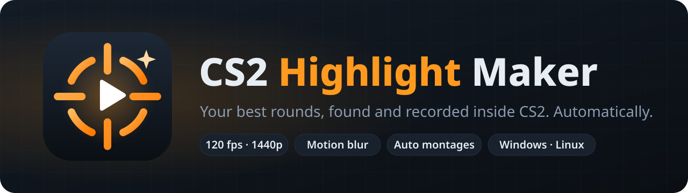
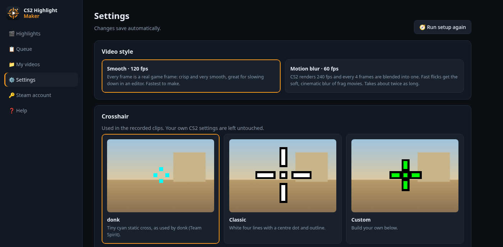
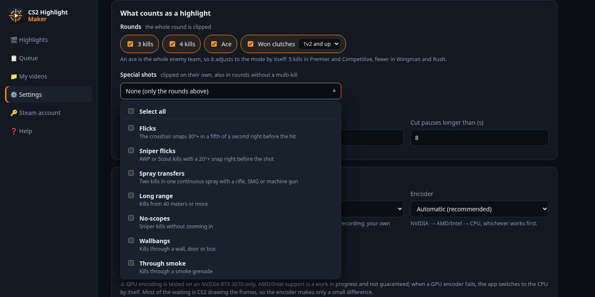

<p align="center">
  
</p>

<p align="center">
  <a href="https://github.com/Ary-x86/cs2-highlight-maker/releases/latest"></a>
  <a href="https://github.com/Ary-x86/cs2-highlight-maker/actions/workflows/tests.yml"></a>
  
  <a href="LICENSE"></a>
</p>

A free alternative to Leetify-style highlight clips that runs on your own PC. Log in with Steam, click **Make highlights of my latest match**, and get a clip of every multi-kill and clutch plus a montage of the whole match.

- **Smooth recording.** CS2 itself renders every frame at a fixed frame rate: 120 fps, or 240 fps blended down to 60 fps for motion blur. It isn't screen capture, so a busy PC can't make it stutter.
- **Downloads your matches for you.** Ranked Competitive, Premier, Rush, Wingman and other replays come from your Steam match history and are deleted after rendering. If you already downloaded a replay yourself, the app uses that copy.
- **You pick what counts.** Choose 3k, 4k, ace or clutch rounds. Optional special shots: flicks, sniper flicks, spray transfers, long range kills, no-scopes, wallbangs, kills through smoke, jump shots, blind kills, kills right after pushing out of a smoke, and pistol headshots against rifles.
- **Queue and montages.** Tick several matches and they render one after another. Each match gets its own clips and montage.
- **1080p or 1440p, your graphics or Very High.** Record at 1440p and save at 1080p for extra sharpness. Graphics are raised only while recording, and your own settings come back afterwards.
- **Crosshairs.** Use donk's, a classic one, or build your own. There's a live preview.
- **Explains what happened.** You see live progress, the time left and a log. Errors say what went wrong and how to fix it.

<p align="center">
  
  
</p>

## Download and install

You need Counter-Strike 2 installed through Steam, and a PC that can run it.

### Windows 10 / 11

1. Download **`CS2HighlightMaker-Setup.exe`** from the [latest release](https://github.com/Ary-x86/cs2-highlight-maker/releases/latest) and run it.
   - If you'd rather not install anything, take `CS2HighlightMaker-windows-x64-portable.zip`, unzip it anywhere and run `CS2HighlightMaker.exe`.
2. Windows SmartScreen may warn that the app is unrecognised, because it isn't code-signed. Click **More info → Run anyway**.
3. A setup screen opens on first start. It finds CS2 and your Steam accounts. If FFmpeg is missing, it downloads it for you with one click. You can also install FFmpeg yourself with `winget install ffmpeg`.

The app opens in its own window. It uses Edge or Chrome for that window, so nothing extra needs installing.

> **Windows support is new.** It is built and tested automatically, but it hasn't been tried on a real Windows PC with CS2 yet. If something fails, please [open an issue](https://github.com/Ary-x86/cs2-highlight-maker/issues) and include the log from the queue page.

### Linux

**Option A: install from source.** This is recommended and gives you an app menu entry.

```sh
git clone https://github.com/Ary-x86/cs2-highlight-maker && cd cs2-highlight-maker && ./install.sh
```

The installer:
- asks before installing anything that's missing (ffmpeg, a C++ compiler, uv). It works with pacman, apt, dnf and zypper.
- asks where to keep the workspace. Pick a disk with a few GB free, because frames are stored there while recording.
- builds the recording plugin.
- adds **CS2 Highlight Maker** to your app menu and opens it.

To update later, run `git pull && ./install.sh`.

**Option B: prebuilt download.** Get `CS2HighlightMaker-linux-x86_64.tar.gz` from the [latest release](https://github.com/Ary-x86/cs2-highlight-maker/releases/latest), then run:

```sh
tar xzf CS2HighlightMaker-linux-x86_64.tar.gz
./CS2HighlightMaker/CS2HighlightMaker
```

Install `ffmpeg` with your package manager, for example `sudo apt install ffmpeg` or `sudo pacman -S ffmpeg`.

### macOS

Not supported. Valve doesn't make Counter-Strike 2 for macOS, and the clips are recorded inside the game. The app runs on a Mac, but it can only list the highlights in a demo (`cs2hl list`).

### Why there's no Docker image

Recording happens inside the real CS2 game. That needs Steam, your GPU, a display and the game files. None of that fits in a container in a way that would be easier than the installers above.

## Using it

1. **Steam account** page: scan the QR code with the Steam mobile app, or log in with your password and Steam Guard code. The login is stored only on your PC.
2. **Highlights** page: click **Make highlights of my latest match**, or tick matches and press **+ Add to queue**.
   - **Demos on this PC** lists `.dem` and `.dem.bz2` files in your CS2 replays folder.
   - **Open on Steam ↗** opens the Steam page with the *Download Replay* buttons. If you download a replay there and put it in the replays folder (or leave it in Downloads), the app uses that file instead of downloading it again.
3. Watch the progress panel. CS2 opens, records and closes by itself, so don't touch it while it works. A match with four highlights takes about 15 minutes in Smooth mode and about 30 with motion blur.
4. **My videos** page: play the clips, or open the folder they're in. Click **✔ made** on a match to jump to its videos.

Everything is also explained on the in-app **Help** page. The setup screen can be reopened from Settings or Help.

### Video styles

| style | how | result |
|---|---|---|
| Smooth · 120 fps (default) | every game frame is kept | crisp; can be slowed down 2× in an editor |
| Motion blur · 60 fps | 240 fps rendered, 4 frames averaged per output frame | soft, cinematic blur on fast flicks; about 2× slower |

Motion blur strength goes from 1× to 2×. Above 1×, each output frame also blends part of the previous one (1.5× averages 6 rendered frames, 2× averages 8), so the smear gets longer. Recording time stays the same.

### File quality

| | how | for |
|---|---|---|
| Standard (default) | JPG frames from CS2, normal encode (~45 Mbit/s at 1440p) | everyday clips |
| Clean | lossless TGA frames, packed on the fly into visually lossless chunks so they never fill the disk; lower quality number, look-ahead and adaptive quantisation in the final encode | no blocking in fast motion, cleaner colours around the crosshair; files 2–3× bigger. Optional full colour (4:4:4) keeps thin coloured lines perfectly clean, but plays only in VLC, mpv and editors |
| Small files | H.264 (x264 on the CPU), AAC, 60 fps; 5 levels from 720p (~3.5 MB per 15 s) to 1080p (~16 MB per 15 s) | WhatsApp, Discord, phones, or low disk space |

All profiles write standard BT.709 colour, so phones and browsers show the same colours as desktop players.

### Encoders

**Automatic** picks a GPU encoder and falls back to the CPU if that one fails:

| GPU | Windows | Linux |
|---|---|---|
| NVIDIA | NVENC | NVENC |
| AMD | AMF | VAAPI |
| Intel | Quick Sync | VAAPI |

GPU encoding has been tested on an NVIDIA RTX 3070 only. Support for other GPUs is a work in progress. Encoding takes a few seconds per clip, because most of the time goes into CS2 drawing the frames.

### Your CS2 settings stay yours

Anything the recording session touches is set back to your own values before CS2 quits: volume, HUD and crosshair. Your video settings (display mode, resolution, graphics) are saved before recording and restored once CS2 has closed. If CS2 crashes, the next recording or `cs2hl clean` puts them back.

## Where things are stored

| | Linux | Windows |
|---|---|---|
| Settings, queue, Steam login, plugin, temporary frames | `~/.local/share/cs2hl/` | `%LOCALAPPDATA%\cs2hl\` |
| Videos (changeable in Settings) | `…/cs2hl/clips/` and `…/cs2hl/montages/` | same, under `%LOCALAPPDATA%\cs2hl\` |

Your settings file is created the first time you finish the setup screen. [`config.example.toml`](config.example.toml) documents every option.

## How it works

1. [demoparser2](https://github.com/LaihoE/demoparser) finds the rounds and kills you picked in Settings.
   - By default that's 3k, 4k, aces and won 1v2+ clutches.
   - Flicks are measured from your view angles in the 0.2 s before the first hit.
   - Smoke pushes compare your position with every active smoke in the 3 s before a kill.
   - Spray transfers come from continuous `weapon_fire` events.
   - Long pauses between kills are cut out.
2. The [CS Demo Manager](https://github.com/akiver/cs-demo-manager) CS2 server plugin runs console commands at given demo ticks.
   - The app loads the plugin into CS2 only for the recording. CS2 starts with `-insecure`, which turns VAC off for that session, so there's no ban risk.
   - CS2 then seeks to each highlight, spectates you and records with `startmovie … jpg wav` (or `tga wav` for Clean) at a locked `host_framerate`.
3. FFmpeg encodes the frames, joins multi-part highlights and builds the montage.

The upstream plugin stopped running tick actions after the 2026-08-19 CS2 update ([cs-demo-manager#1458](https://github.com/akiver/cs-demo-manager/issues/1458)). [`plugin/frame-hook.patch`](plugin/frame-hook.patch) fixes that. [`plugin/build.sh`](plugin/build.sh) (Linux) and [`plugin/build.ps1`](plugin/build.ps1) (Windows) build the patched plugin.

Match history is read from Steam's *Personal Game Data* pages, the ones with **Download Replay** buttons. The replay links point at Valve's own servers over plain HTTP, which is why browsers call them unsafe.

## Command line

The `cs2hl` command is available after `./install.sh` (Linux) or `pip install .`:

```sh
cs2hl               # open the app
cs2hl latest        # render your latest Steam match
cs2hl run [demo…]   # render new demos in the CS2 replays folder (or the given files)
cs2hl list [demo…]  # show detected highlights without rendering
cs2hl watch         # keep running, render demos as they appear in the replays folder
cs2hl clean         # remove the plugin from CS2 after a crash
cs2hl config        # print settings
```

To run the watcher at login on Linux:

```sh
mkdir -p ~/.config/systemd/user && cp systemd/cs2hl-watch.service ~/.config/systemd/user/
systemctl --user enable --now cs2hl-watch
```

## Development

```sh
python -m venv .venv && . .venv/bin/activate   # Windows: .venv\Scripts\activate
pip install -e .
python -m unittest discover -s tests            # runs on Linux, Windows and macOS in CI
python -m cs2hl gui                              # start the app from source
```

| folder | what |
|---|---|
| `cs2hl/` | the app: highlight detection (`detect.py`), CS2 control (`game.py`), encoding (`encode.py`), Steam (`steam.py`), OS differences (`system.py`), GUI (`gui/`) |
| `plugin/` | patch and build scripts for the recording plugin |
| `packaging/` | PyInstaller build, Windows installer script, release notes |
| `tests/` | unit tests (no CS2 needed) |

**Packaged builds:** `pip install pyinstaller`, then run `python packaging/build.py --plugin <libserver.so or server.dll>`. The app folder is written to `dist/`.

**Releases:** push a tag such as `v0.2.0`. The [release workflow](.github/workflows/release.yml) then:
- builds the plugin for both systems (in Steam's runtime SDK on Linux, with MSVC on Windows)
- builds the Windows installer, the portable zip and the Linux tarball
- publishes them on the Releases page

## Credits

- [CS Demo Manager](https://github.com/akiver/cs-demo-manager) by akiver, for the CS2 server plugin this builds on (MIT)
- [demoparser2](https://github.com/LaihoE/demoparser) by LaihoE, for demo parsing
- [FFmpeg](https://ffmpeg.org/), for encoding. Windows builds are downloaded from [BtbN/FFmpeg-Builds](https://github.com/BtbN/FFmpeg-Builds)

Not affiliated with Valve. Counter-Strike and Steam are trademarks of Valve Corporation.

## License

[MIT](LICENSE)
